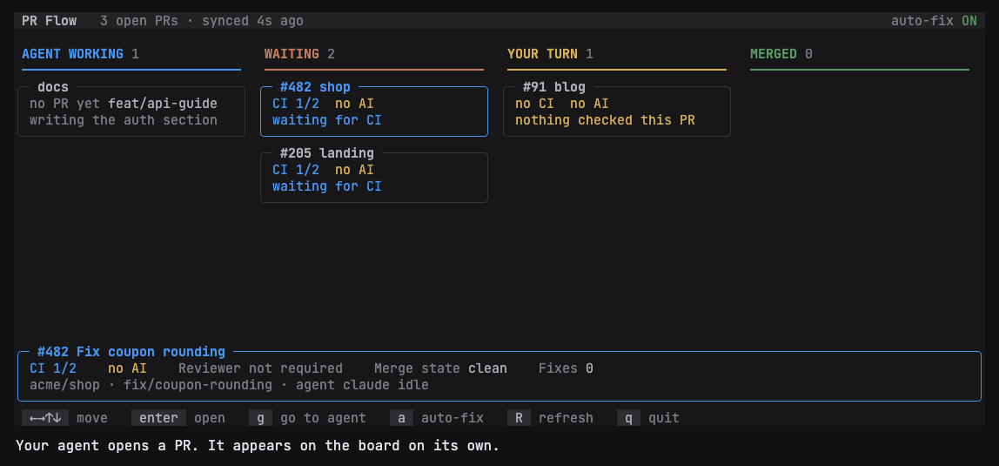
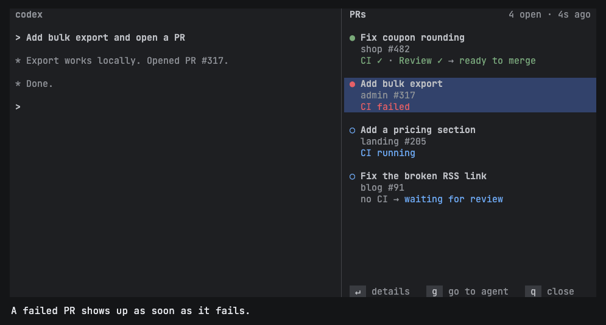
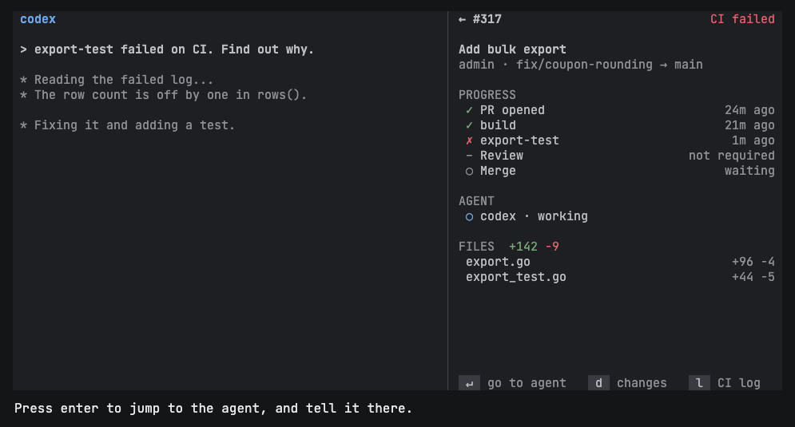
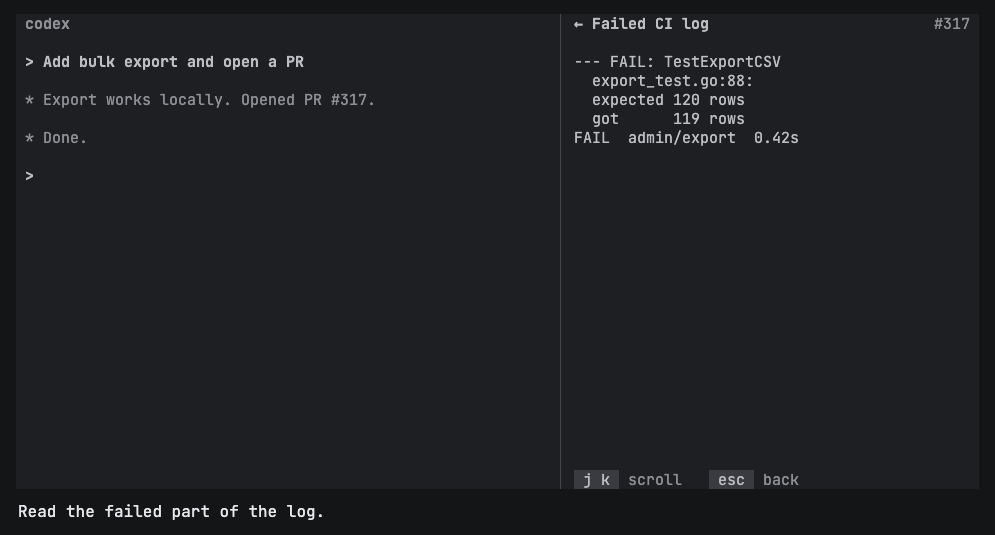
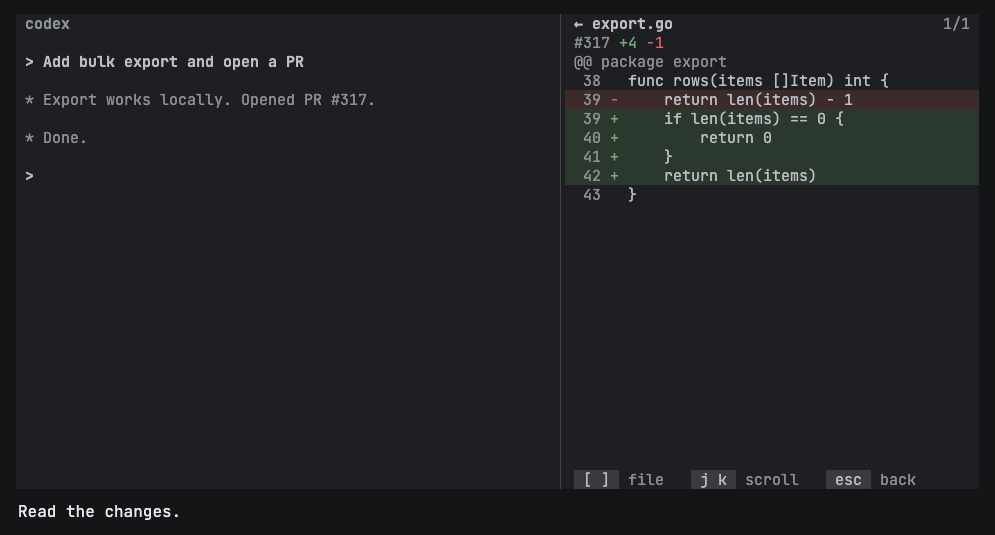
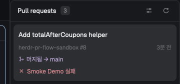
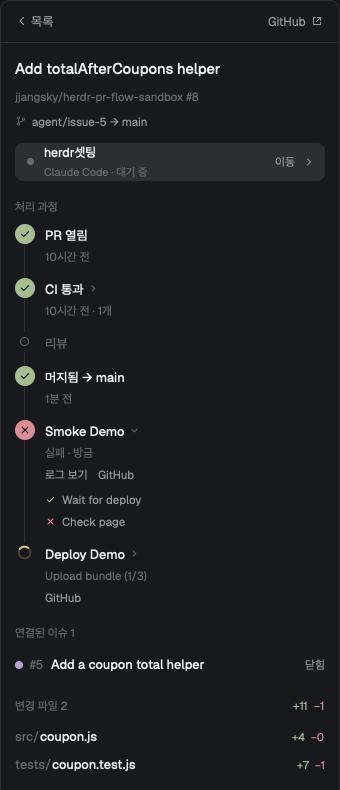
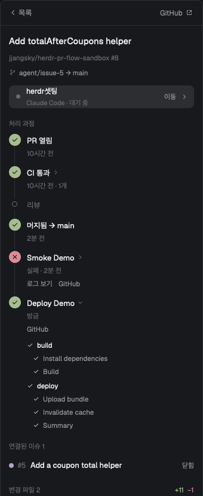
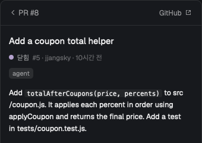

# PR Flow

[English](README.md) | **한국어**

에이전트가 올린 PR과 각 PR의 처리 상태를 [Herdr](https://herdr.dev) 안에서 바로 보여줍니다.



*터미널 플러그인의 실제 화면을 샘플 데이터로 그린 영상입니다.*

PR Flow는 조회만 합니다. GitHub에 아무것도 쓰지 않고 에이전트에게 아무것도 보내지 않습니다. 할 일이 있으면 그 에이전트로 이동해서 직접 말하면 됩니다.

- **설정 없음:** Herdr에서 돌아가는 에이전트의 브랜치에 PR이 있으면 자동으로 나타납니다.
- **있는 그대로의 상태:** `CI ✓ → 리뷰 대기`처럼 끝난 단계와 지금 상태를 보여줍니다. CI가 없는 저장소는 `CI 없음`으로 표시하고, 통과로 치지 않습니다.
- **패널에서 자세히 보기:** PR을 열면 처리 과정, 담당 에이전트, 변경 파일과 diff, 실패한 CI 로그를 볼 수 있습니다.

## 목차

- [두 가지 버전](#두-가지-버전)
- [현재 상태](#현재-상태)
- [준비물](#준비물)
- [터미널 플러그인](#터미널-플러그인)
- [데스크톱 앱 모드](#데스크톱-앱-모드)
- [PR 상태 읽는 법](#pr-상태-읽는-법)
- [PR을 찾고 갱신하는 방식](#pr을-찾고-갱신하는-방식)
- [설정](#설정)
- [문제 해결](#문제-해결)
- [제한 사항](#제한-사항)
- [개발](#개발)

## 두 가지 버전

| | 터미널 플러그인 | 데스크톱 앱 모드 |
| --- | --- | --- |
| 실행 위치 | Herdr(`herdr`)의 pane | Herdr 데스크톱 앱(`herdr-app`)의 고정 패널 |
| 설치 방법 | `herdr plugin install` | `~/.config/herdr-app/mods/`에 폴더 복사 |
| 조작 | 키보드 | 마우스와 키보드 |
| 처리 과정, 에이전트, 파일, diff, 실패한 CI 로그 | 있음 | 있음 |
| 머지 후 Actions 실행 | 없음 | 있음 (단계별로 표시) |
| 연결된 이슈 | 없음 | 있음 |
| 언어 | `config.toml`의 `lang` | 패널의 설정 버튼 |

쓰고 있는 Herdr에 맞는 버전을 고르면 됩니다. 두 버전은 상태를 공유하지 않습니다.

## 현재 상태

초기 버전(0.2.0)입니다. 실제 PR과 Claude Code 에이전트로 시험했습니다. Codex 같은 다른 에이전트로는 아직 시험하지 않았습니다. 데스크톱 앱 모드는 macOS의 `herdr-app` 0.1.12에서만 실행해 봤습니다.

## 준비물

- 로그인된 [GitHub CLI](https://cli.github.com) (`gh auth status`로 확인)
- 터미널 플러그인: Herdr 0.9.3 이상, Node.js 20 이상, Linux 또는 macOS
- 데스크톱 앱 모드: Herdr 데스크톱 앱

## 터미널 플러그인

### 설치하고 열기

```sh
herdr plugin install jjangsky/herdr-pr-flow
```

Herdr의 pane에서 아래 명령을 실행하면 그 옆에 패널이 열립니다. 옆에 둘 pane이 없으면 탭으로 열립니다.

```sh
herdr plugin action invoke open --plugin jjangsky.pr-flow
```

단축키로 열려면 `~/.config/herdr/config.toml`에 추가하고 `herdr server reload-config`를 실행합니다.

```toml
[[keys.command]]
key = "prefix+p"
type = "plugin_action"
command = "jjangsky.pr-flow.open"
description = "PR Flow"
```

### 사용 흐름

위 영상은 약 24초 길이이고, 실패한 PR 하나를 처음부터 끝까지 따라갑니다. 아래는 같은 화면을 정지 이미지로 옮긴 것입니다. 샘플 화면이라 영어로 표시됩니다.

**1. 목록 보기:** PR마다 제목, 저장소와 번호, 현재 상태가 나옵니다. 실패한 PR에는 빨간 점이 붙습니다. `j`, `k`로 이동하고 `enter`로 엽니다.



**2. PR 열기:** 단계별 시간, 에이전트와 그 작업 내용, 변경 파일을 볼 수 있습니다.



**3. 실패 로그 읽기:** `l`을 누릅니다. 실패 내용은 보통 끝에 있으므로 로그 맨 아래부터 열립니다.



**4. 변경 내용 읽기:** `d`를 누릅니다. `[` `]`로 파일을 바꿉니다.



**5. 에이전트에게 말하기:** `enter`로 이 PR을 작업하는 에이전트로 이동해서 할 일을 말합니다. 바뀐 상태는 패널에 자동으로 반영됩니다.

### 단축키

| 화면 | 키 | 동작 |
| --- | --- | --- |
| 목록 | `j` `k`, 방향키 | 이동 |
| 목록 | `enter` | PR 열기 |
| 목록 | `g` | 에이전트로 이동 |
| 목록 | `R` | 선택한 PR 새로고침 |
| 목록 | `q`, `ctrl-c` | 닫기 |
| PR | `enter`, `g` | 에이전트로 이동 |
| PR | `d` | 변경 내용 보기 |
| PR | `l` | 실패한 CI 로그 보기 (실패한 체크가 있을 때) |
| PR | `o` | GitHub에서 열기 |
| PR | `R` | 새로고침 |
| PR | `j` `k`, 방향키, `space`, 페이지 키 | 스크롤 |
| PR | `esc`, `q` | 뒤로 |
| 변경 내용 | `[` `]` | 이전 또는 다음 파일 |
| 변경 내용, 로그 | `j` `k`, 방향키, `space`, 페이지 키 | 스크롤 |
| 변경 내용, 로그 | `esc`, `q` | 뒤로 |

## 데스크톱 앱 모드

### 설치하고 열기

```sh
git clone https://github.com/jjangsky/herdr-pr-flow
mkdir -p ~/.config/herdr-app/mods
cp -R herdr-pr-flow/pr-flow/mods/pr-flow ~/.config/herdr-app/mods/
herdr-app check ~/.config/herdr-app/mods/pr-flow
```

앱이 이 폴더를 처음 발견하면 오른쪽에 너비 340픽셀로 패널을 붙입니다. 그 뒤로는 레이아웃에 저장된 위치를 따릅니다. `pr-flow` 폴더가 이미 있으면 덮어쓰기 전에 내용을 확인하세요. 제거하려면 폴더를 지우면 됩니다.

### 사용 흐름

아래는 실제 실행 화면입니다.

**1. 목록:** 카드마다 PR, 연결된 이슈, CI와 리뷰, 에이전트가 나옵니다. 머지된 PR은 Actions 실행 결과도 함께 보여줍니다. 위쪽 버튼으로 설정을 열거나 새로고침합니다.



**2. 머지 후 따라가기:** PR을 열면 타임라인이 나옵니다. 머지 후에는 Actions 실행마다 줄이 생기고, `Upload bundle (1/3)`처럼 진행 위치를 보여줍니다. 실패한 실행에는 로그 보기가 있습니다. 실행을 클릭하면 펼쳐집니다.



**3. 단계별로 보기:** 펼친 실행에는 job과 step이 나열됩니다. 연결된 이슈와 변경 파일도 같은 화면에 있습니다. 파일을 클릭하면 diff를 볼 수 있습니다.



**4. 이슈 읽기:** 연결된 이슈를 클릭하면 라벨, 코멘트와 함께 패널에서 읽을 수 있습니다. 뒤로 버튼을 누르면 PR로 돌아갑니다.



**5. 에이전트에게 말하기:** PR 위쪽의 에이전트 줄을 클릭하거나 `enter`를 누르면 그 터미널로 이동합니다.

### 단축키

패널을 한 번 클릭하면 키를 받습니다.

| 화면 | 키 | 동작 |
| --- | --- | --- |
| 목록 | `j` `k`, 방향키 | 이동 |
| 목록 | `enter` | PR 열기 |
| 목록 | `g` | 에이전트로 이동 |
| 목록 | `o` | GitHub에서 열기 |
| 목록 | `r` | 새로고침 |
| PR | `enter`, `g` | 에이전트로 이동 |
| PR | `o` | GitHub에서 열기 |
| PR | `esc`, `backspace` | 뒤로 |
| 이슈 | `o` | GitHub에서 열기 |
| 이슈 | `esc`, `backspace` | PR로 돌아가기 |

## PR 상태 읽는 법

터미널 플러그인은 화살표 뒤에 상태 하나를 보여줍니다. 아래 표에서 가장 먼저 해당하는 상태가 표시되므로, 가장 막고 있는 문제가 먼저 나옵니다.

| 상태 | 뜻 |
| --- | --- |
| `머지됨` / `닫힘` | PR이 끝남 |
| `초안` | 아직 초안으로 표시됨 |
| `머지 충돌` | GitHub가 기준 브랜치와의 충돌을 보고함 |
| `CI 실패` | 체크가 실패함 |
| `CI 실행 중` | 체크가 실행 중이거나, 새 커밋 후 `ci_wait` 시간이 아직 지나지 않음 |
| `변경 요청됨` | 리뷰어가 변경을 요청함 |
| `코멘트 N건` | 해결되지 않았고 오래되지도 않은 리뷰 스레드 |
| `AI 리뷰 중` | AI 리뷰 작업이 실행 중 |
| `리뷰 대기` | 저장소가 요구하는 리뷰가 아직 없음 |
| `기준 브랜치보다 뒤처짐` | 브랜치가 기준 브랜치보다 뒤처짐 |
| `브랜치 규칙에 막힘` | 브랜치 규칙이 머지를 막음 |
| `머지 가능` | 위 어디에도 해당하지 않음 |

`머지 가능`은 GitHub가 보고한 상태일 뿐, 변경 내용을 평가한 결과가 아닙니다.

화살표 앞의 `CI ✓`, `리뷰 ✓`, `CI 없음`은 이미 끝난 단계입니다. AI 리뷰 작업의 결과는 CI로 치지 않으므로, 실패해도 `CI 실패`로 표시하지 않습니다.

## PR을 찾고 갱신하는 방식

PR Flow는 Herdr에 실행 중인 에이전트를 물어본 뒤, 각 에이전트의 브랜치에 있는 PR을 `gh`로 찾습니다. 조회 명령만 사용합니다.

| | 터미널 플러그인 | 데스크톱 앱 모드 |
| --- | --- | --- |
| 에이전트 확인 | 3초마다 | 5초마다 |
| 브랜치의 새 PR 찾기 | 30초마다 | 에이전트가 작업 중이면 30초, 쉬는 중이면 2분마다 |
| 열린 PR 갱신 | `poll_seconds`마다 | `poll_seconds`마다 |
| 실행 중인 에이전트가 없는 PR 갱신 | 4배 느리게 | 4배 느리게 |
| 에이전트가 작업을 멈췄을 때 | PR을 바로 갱신 | PR을 바로 찾고 갱신 |
| 머지 후 Actions 실행 | 표시 안 함 | 실행 중에는 15초마다 |
| 기억하는 PR 저장 위치 | 플러그인 상태 폴더의 `tracked.json` | 모드 자체 저장소 |

## 설정

두 버전 모두 설정 없이 동작합니다.

### 터미널 플러그인

`herdr plugin config-dir jjangsky.pr-flow`가 알려주는 폴더에 `config.toml`을 만듭니다.

```toml
poll_seconds = 30
ci_wait = "2m"
lang = "ko"
ai_checks = ["nightly review"]
```

| 키 | 기본값 | 뜻 |
| --- | --- | --- |
| `poll_seconds` | `30` | 열린 PR을 갱신하는 주기. 최솟값은 10 |
| `ci_wait` | `"2m"` | 새 커밋 후 체크를 기다렸다가 `CI 없음`으로 표시하기까지의 시간. 단위는 `ms`, `s`, `m`, `h` |
| `lang` | 시스템 언어 | `"en"` 또는 `"ko"` |
| `ai_checks` | `[]` | 실제로는 AI 리뷰인 CI 작업의 정확한 이름 |

`claude-review` 같은 작업은 이름으로 AI 리뷰임을 알아봅니다. 다른 이름은 `ai_checks`에 추가하세요.

이 파일은 최상위 `key = value` 줄과 `#` 주석만 지원합니다.

### 데스크톱 앱 모드

언어는 패널의 설정 버튼에서 고릅니다. 나머지 값은 `~/.config/herdr-app/layouts/`의 레이아웃 파일에서 모드의 `props`에 넣습니다.

```json
{
  "type": "block",
  "content": {
    "mod": "pr-flow",
    "props": { "poll_seconds": 60, "ci_wait": "5m", "ai_checks": ["nightly review"] }
  },
  "size": { "px": 340 }
}
```

## 문제 해결

| 증상 | 해결 방법 |
| --- | --- |
| PR이 나타나지 않음 | 그 브랜치에서 Herdr 에이전트가 실행 중인지, 그 폴더에서 `gh pr list --head <branch>`로 열린 PR이 찾아지는지 확인 |
| `Cannot read line N of config.toml` | 해당 줄을 고칩니다. 문자열은 큰따옴표로 감싸야 하고, `[section]` 같은 테이블은 지원하지 않습니다 |
| 목록 위쪽의 `gh:` 오류, 또는 `GitHub CLI를 쓸 수 없습니다` | `gh auth login` 실행 후 새로고침 |
| CI가 있는 저장소인데 `CI 없음` | `ci_wait` 안에 체크가 보고되지 않은 경우입니다. 값을 늘리세요 |
| AI 리뷰가 `CI 실패`로 표시됨 | 작업의 정확한 이름을 `ai_checks`에 추가 |
| `실패 로그가 없습니다` 또는 링크만 표시됨 | 로그는 GitHub Actions만 불러옵니다. 다른 CI는 링크만 보여줍니다 |
| 모드가 나타나지 않음 | `herdr-app check ~/.config/herdr-app/mods/pr-flow`와 `herdr-app status`로 불러오기 오류를 확인 |

## 제한 사항

- PR은 Herdr에서 돌아가는 에이전트를 통해, 열려 있는 동안에만 찾습니다. PR Flow가 보기 전에 머지되거나 닫힌 PR은 추가되지 않습니다. 이미 목록에 있는 PR은 에이전트가 종료돼도 닫히거나 머지 후 24시간이 지날 때까지 남습니다.
- GitHub에 결과를 보고하는 CI만 보입니다.
- 패널이 열려 있어야 상태가 갱신되고, 저장소는 GitHub에 있어야 합니다.
- 갱신할 때마다 `gh`를 실행하므로 열린 PR이 많으면 GitHub API 한도를 더 씁니다. 필요하면 `poll_seconds`를 늘리세요.

## 개발

```sh
npm test                                      # 두 버전 모두
herdr plugin link "$PWD"                      # 이 폴더의 터미널 플러그인 실행
node bin/board.js --dump --plain --pr <url>   # 실제 PR의 스냅샷
node scripts/demo-frames.js <dir>             # README 데모 프레임을 HTML로 생성
herdr-app check pr-flow/mods/pr-flow          # 모드를 한 번 불러와 오류 확인
```

터미널 플러그인은 `bin/`과 `src/`에, 데스크톱 앱 모드는 `pr-flow/mods/pr-flow/`에 있습니다. 모드 테스트는 `tests/mod/`에 있습니다.

`scripts/demo-frames.js`는 HTML 프레임만 만듭니다. 이를 `docs/demo.gif`로 렌더링하는 건 별도 작업입니다. `docs/images/plugin-*.png`는 그 GIF의 프레임이므로 함께 갱신하세요.

## 라이선스

MIT
