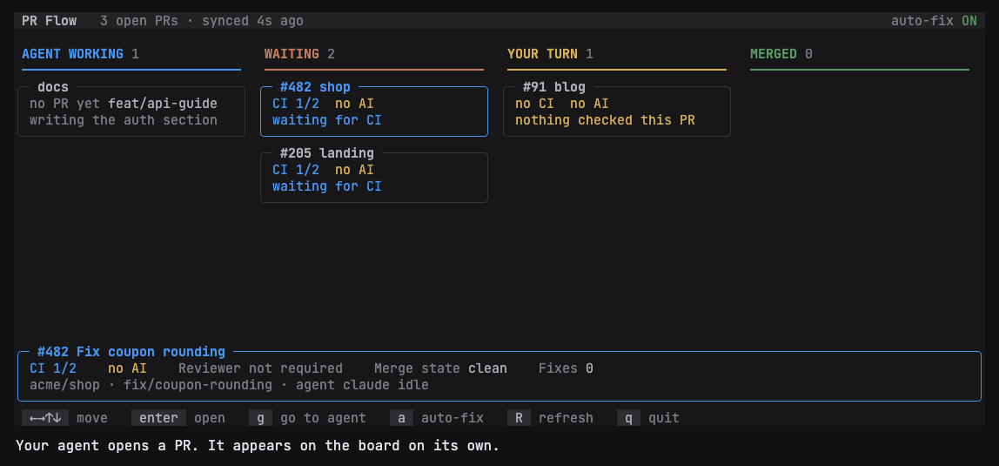
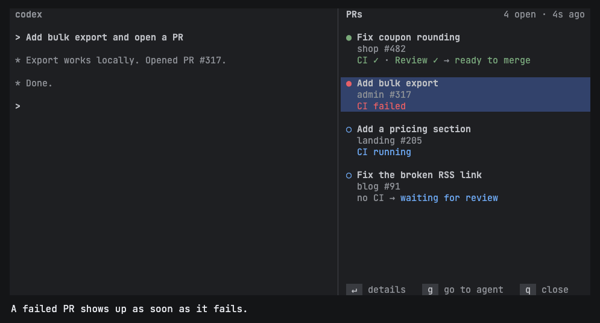
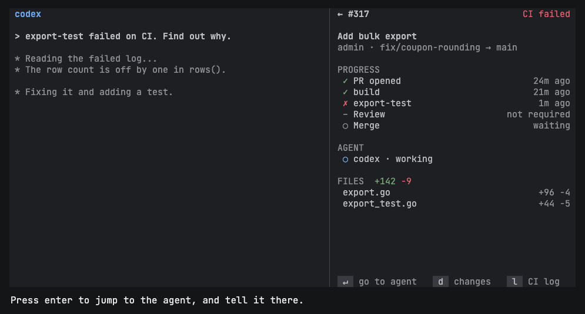
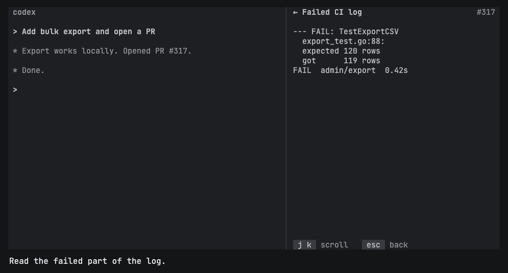
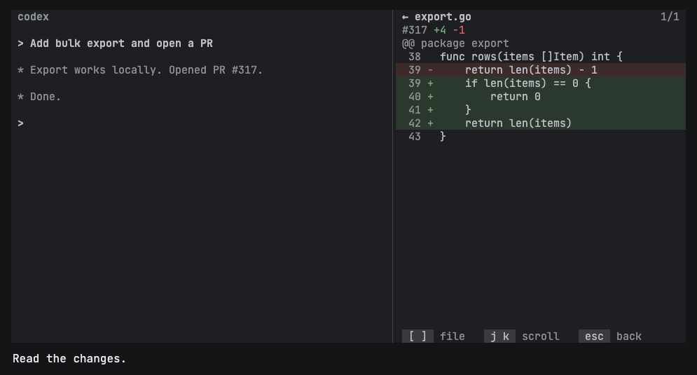
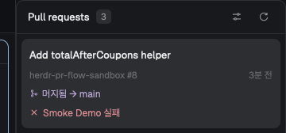
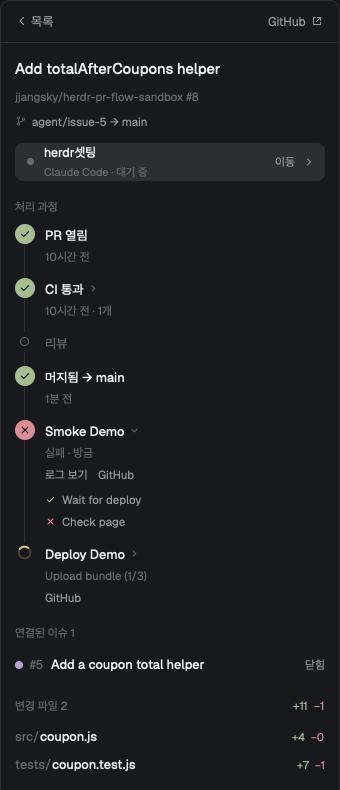
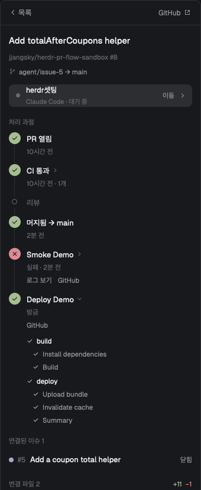
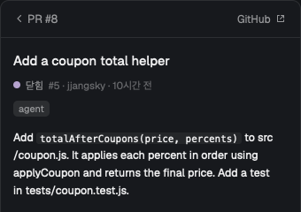

# PR Flow

**English** | [한국어](README.ko.md)

See every pull request your agents opened and where each one is, without leaving [Herdr](https://herdr.dev).



*The terminal plugin's real screens, drawn with sample data.*

PR Flow only reads. It never writes to GitHub or sends anything to an agent. When something needs doing, jump to the agent and tell it there.

- **No setup.** A PR appears when an agent running in Herdr has one on its branch.
- **Plain state.** Each row shows what finished and what is happening now, such as `CI ✓ → waiting for review`. A repo with no CI says `no CI`, and never counts as passed.
- **Details in the panel.** Open a PR to see its progress, agent, changed files, diff, and the failed part of a CI log.

## Contents

- [Two versions](#two-versions)
- [Status](#status)
- [Requirements](#requirements)
- [Terminal plugin](#terminal-plugin)
- [Desktop app mod](#desktop-app-mod)
- [Reading a PR's state](#reading-a-prs-state)
- [How PRs are found and refreshed](#how-prs-are-found-and-refreshed)
- [Configuration](#configuration)
- [Troubleshooting](#troubleshooting)
- [Limits](#limits)
- [Development](#development)

## Two versions

| | Terminal plugin | Desktop app mod |
| --- | --- | --- |
| Runs in | Herdr (`herdr`), as a pane | Herdr desktop app (`herdr-app`), as a docked panel |
| Installed with | `herdr plugin install` | Copying a folder into `~/.config/herdr-app/mods/` |
| Used with | Keyboard | Mouse and keyboard |
| Progress, agent, files, diff, failed CI log | Yes | Yes |
| Actions runs after a merge | No | Yes, down to each step |
| Linked issues | No | Yes |
| Language | `lang` in `config.toml` | Settings button in the panel |

Use the version that matches the Herdr you run. They don't share state.

## Status

Early release (0.2.0). It has been run against real pull requests with real Claude Code agents. Other agents such as Codex haven't been tried. The desktop app mod has been run on macOS with `herdr-app` 0.1.12 only.

## Requirements

- [GitHub CLI](https://cli.github.com) logged in (`gh auth status`)
- For the terminal plugin: Herdr 0.9.3 or later and Node.js 20 or later, on Linux or macOS
- For the desktop app mod: the Herdr desktop app

## Terminal plugin

### Install and open

```sh
herdr plugin install jjangsky/herdr-pr-flow
```

Open it from a pane in Herdr, and the panel appears beside that pane. With no pane to sit beside, it opens as a tab.

```sh
herdr plugin action invoke open --plugin jjangsky.pr-flow
```

To open it with a key, add this to `~/.config/herdr/config.toml` and run `herdr server reload-config`:

```toml
[[keys.command]]
key = "prefix+p"
type = "plugin_action"
command = "jjangsky.pr-flow.open"
description = "PR Flow"
```

### Walkthrough

The demo above runs for about 24 seconds and follows one failed PR from start to finish. These are the same screens as stills.

**1. Watch the list.** Each PR shows its title, repo and number, and current state. A failed PR gets a red dot. Move with `j` and `k`, and press `enter` to open one.



**2. Open the PR.** You see each step with its time, the agent and what it is doing, and the changed files.



**3. Read the failed log.** Press `l`. The log opens at the bottom, where failures usually are.



**4. Read the changes.** Press `d`, and use `[` `]` to change file.



**5. Tell the agent.** Press `enter` to jump to the agent working on the PR, and tell it what to do there. The panel picks up the new state on its own.

### Keys

| Screen | Key | Action |
| --- | --- | --- |
| List | `j` `k`, arrows | Move |
| List | `enter` | Open the PR |
| List | `g` | Go to the agent |
| List | `R` | Refresh the selected PR |
| List | `q`, `ctrl-c` | Close |
| PR | `enter`, `g` | Go to the agent |
| PR | `d` | Show changes |
| PR | `l` | Show the failed CI log, when a check failed |
| PR | `o` | Open on GitHub |
| PR | `R` | Refresh |
| PR | `j` `k`, arrows, `space`, page keys | Scroll |
| PR | `esc`, `q` | Back |
| Changes | `[` `]` | Previous or next file |
| Changes, log | `j` `k`, arrows, `space`, page keys | Scroll |
| Changes, log | `esc`, `q` | Back |

## Desktop app mod

### Install and open

```sh
git clone https://github.com/jjangsky/herdr-pr-flow
mkdir -p ~/.config/herdr-app/mods
cp -R herdr-pr-flow/pr-flow/mods/pr-flow ~/.config/herdr-app/mods/
herdr-app check ~/.config/herdr-app/mods/pr-flow
```

The first time the app sees the folder, it docks the panel on the right, 340 pixels wide. After that your layout decides where it stays. If a folder named `pr-flow` already exists, look at it before copying over it. To remove the mod, delete the folder.

### Walkthrough

These screenshots come from a real run. The app was set to Korean, and the buttons have the same meaning in English.

**1. The list.** Each card shows the PR, its linked issue, CI and review, and the agent. A merged PR shows how its Actions runs went. Use the buttons at the top for settings and refresh.



**2. Follow a merge.** Open a PR to see its timeline. After a merge, each Actions run gets its own row while it runs, such as `Upload bundle (1/3)`. A failed run offers its log. Click a run to expand it.



**3. See each step.** An expanded run lists its jobs and steps. The screen also shows the linked issues and changed files. Click a file to see its diff.



**4. Read the issue.** Click a linked issue to read it, with its labels and comments, in the panel. Use the back button to return to the PR.



**5. Tell the agent.** Click the agent row at the top of the PR, or press `enter`, to jump to its terminal.

### Keys

The panel takes keys after you click it.

| Screen | Key | Action |
| --- | --- | --- |
| List | `j` `k`, arrows | Move |
| List | `enter` | Open the PR |
| List | `g` | Go to the agent |
| List | `o` | Open on GitHub |
| List | `r` | Refresh |
| PR | `enter`, `g` | Go to the agent |
| PR | `o` | Open on GitHub |
| PR | `esc`, `backspace` | Back |
| Issue | `o` | Open on GitHub |
| Issue | `esc`, `backspace` | Back to the PR |

## Reading a PR's state

The terminal plugin shows one state after the arrow. It is the first of these that applies, so the most blocking one wins.

| State | Meaning |
| --- | --- |
| `merged` / `closed` | The PR is finished |
| `draft` | Still marked as a draft |
| `merge conflict` | GitHub reports a conflict with the base branch |
| `CI failed` | A check failed |
| `CI running` | A check is running, or a new commit is still within `ci_wait` |
| `changes requested` | A reviewer asked for changes |
| `N open comments` | Review threads that are neither resolved nor outdated |
| `AI reviewing` | An AI review job is running |
| `waiting for review` | The repo requires a review that hasn't happened |
| `behind base` | The branch is behind its base |
| `blocked by rules` | Branch rules block the merge |
| `ready to merge` | Nothing above applies |

`ready to merge` reports what GitHub says. It doesn't judge the change.

Before the arrow, `CI ✓`, `Review ✓` and `no CI` show what already finished. An AI review job's result isn't counted as CI, so its failure isn't shown as `CI failed`.

## How PRs are found and refreshed

PR Flow asks Herdr which agents are running, then looks up the PR for each agent's branch with `gh`. Only read commands are used.

| | Terminal plugin | Desktop app mod |
| --- | --- | --- |
| Check agents | Every 3 seconds | Every 5 seconds |
| Look for a new PR on a branch | Every 30 seconds | Every 30 seconds while the agent works, every 2 minutes when idle |
| Refresh an open PR | Every `poll_seconds` | Every `poll_seconds` |
| Refresh a PR with no running agent | 4 times slower | 4 times slower |
| When an agent stops working | Refreshes its PR now | Looks for and refreshes its PR now |
| Actions runs after a merge | Not shown | Every 15 seconds while runs are active |
| Remembered PRs | `tracked.json` in the plugin's state directory | The mod's own storage |

## Configuration

Both versions work without configuration.

### Terminal plugin

Create `config.toml` in the directory printed by `herdr plugin config-dir jjangsky.pr-flow`:

```toml
poll_seconds = 30
ci_wait = "2m"
lang = "ko"
ai_checks = ["nightly review"]
```

| Key | Default | Meaning |
| --- | --- | --- |
| `poll_seconds` | `30` | How often an open PR refreshes. The minimum is 10 |
| `ci_wait` | `"2m"` | How long a new commit waits for checks before showing `no CI`. Units are `ms`, `s`, `m` and `h` |
| `lang` | System language | `"en"` or `"ko"` |
| `ai_checks` | `[]` | CI jobs that are really AI review, by exact name |

Jobs such as `claude-review` are recognized as AI review by name. Add others to `ai_checks`.

The file supports only top-level `key = value` lines and `#` comments.

### Desktop app mod

Choose the language with the settings button in the panel. The other values go in the mod's `props`, in your layout file under `~/.config/herdr-app/layouts/`:

```json
{
  "type": "block",
  "content": {
    "mod": "pr-flow",
    "props": { "poll_seconds": 60, "ci_wait": "5m", "ai_checks": ["nightly review"] }
  },
  "size": { "px": 340 }
}
```

## Troubleshooting

| What you see | What to do |
| --- | --- |
| A PR doesn't appear | Check that an agent is running in Herdr on that branch, and that `gh pr list --head <branch>` finds an open PR from that folder |
| `Cannot read line N of config.toml` | Fix that line. Strings need double quotes, and tables such as `[section]` aren't supported |
| `gh:` error in the list header, or `GitHub CLI is not ready` | Run `gh auth login`, then refresh |
| `no CI` on a repo that has CI | The checks didn't report within `ci_wait`. Raise it |
| An AI review shows as `CI failed` | Add the job's exact name to `ai_checks` |
| `No failed log` or only a link | Logs load for GitHub Actions only. Other CI shows a link |
| The mod doesn't appear | Run `herdr-app check ~/.config/herdr-app/mods/pr-flow` and `herdr-app status`. Both report load errors |

## Limits

- PRs are found through agents running in Herdr, and only while they are open. A PR merged or closed before PR Flow saw it isn't added. A PR already listed stays after its agent exits, until it closes or 24 hours after it merges.
- Only CI that reports to GitHub is visible.
- PR Flow needs to be open to refresh, and a repo must be hosted on GitHub.
- Each refresh runs `gh`, so many open PRs use more of your GitHub API limit. Raise `poll_seconds` if needed.

## Development

```sh
npm test                                      # both versions
herdr plugin link "$PWD"                      # run the terminal plugin from this folder
node bin/board.js --dump --plain --pr <url>   # a snapshot of a real PR
node scripts/demo-frames.js <dir>             # README demo frames as HTML
herdr-app check pr-flow/mods/pr-flow          # load the mod once and report errors
```

The terminal plugin is in `bin/` and `src/`. The desktop app mod is in `pr-flow/mods/pr-flow/`, and its tests are in `tests/mod/`.

`scripts/demo-frames.js` only writes the HTML frames. Rendering them into `docs/demo.gif` is a separate step. The stills in `docs/images/plugin-*.png` are frames from that GIF, so update them together.

## License

MIT
